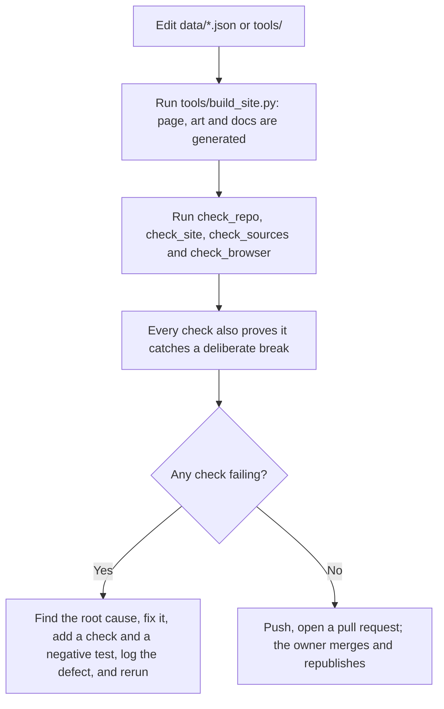
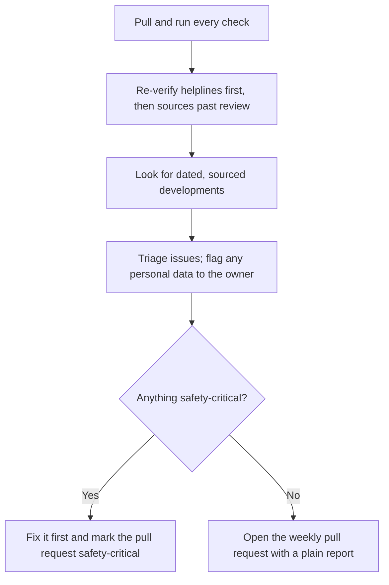
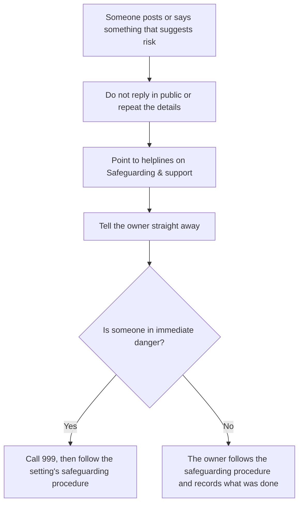
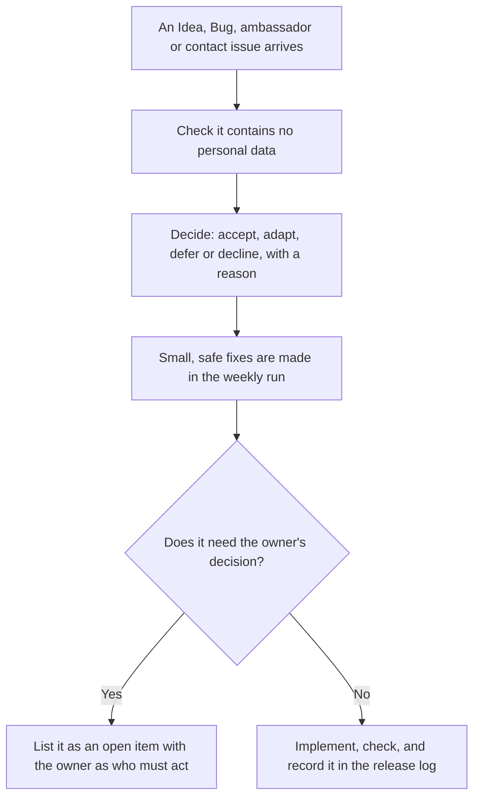
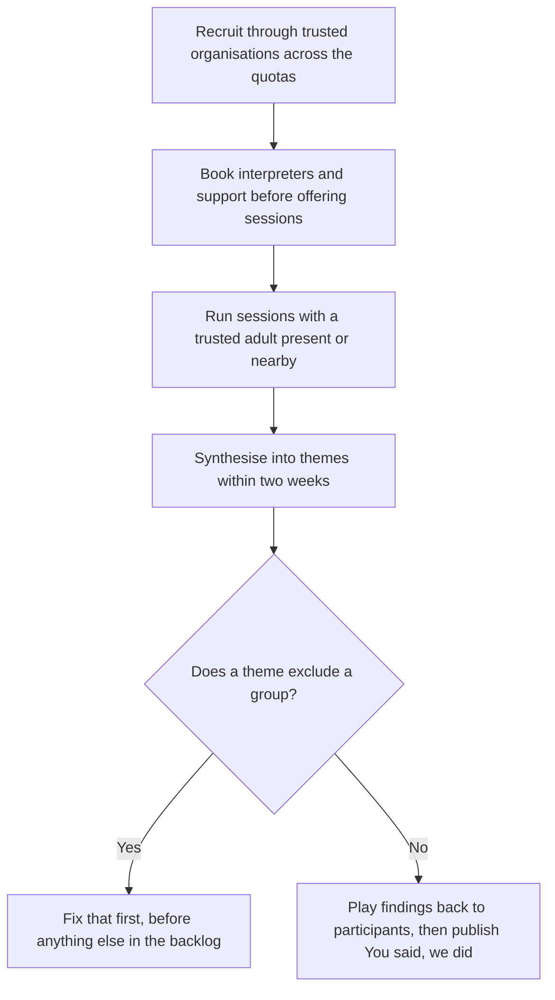

# Processes and workflows

Generated from `data/service-design.json` by `tools/make_docs.py`; edit that, not this file. The portal shows the same content on its Personas & journeys screen.

> **Status:** Proto-personas and assumed journeys, written from the owner's requests, published guidance and the portal's own safeguards. They have not been tested with users yet: research Round 1 (January to February 2027) tests them, and they will change.

## W-BUILD: Build, check and release

## W-UPKEEP: Weekly upkeep

## W-SAFE: A safeguarding concern

## W-CONTRIB: Contribution triage

## W-RESEARCH: Research round

